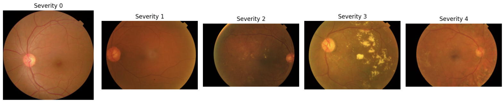

# Introduction

---

## What is Diabetic Retinopathy?

Diabetic Retinopathy is an eye condition in people with diabetes and is the leading cause of blindness among working aged adults ([NIH](https://www.nei.nih.gov/learn-about-eye-health/eye-conditions-and-diseases/diabetic-retinopathy)). The condition is caused by high blood sugar levels, which damage the blood vessels in the retina. Our goal is to build a model that can accurately diagnose the level of severity of diabetic retinopathy through retina images.


:::{iframe} https://www.youtube.com/embed/VIrkurR446s
:width: 100%
:::


---

## Why is this an important problem?
- **Silent progression**: DR often shows no symptoms in its early stages.
- **Preventable vision loss**: With timely treatment, many of these vision loss cases can be prevented.
- **Growing medical burden**: Deep learning models address the increasing need for scalable and accessible screening tools as diabetes becomes more prevalent.

---

## Machine Learning Approach

Machine learning, especially deep learning with convolutional neural networks (CNNs), has shown great promise in analyzing medical images. In this book, we cover:

- The preprocessing of retinal fundus images
- Training deep learning models for DR classification
- Evaluating model performance and addressing class imbalance

### Models

````{tab-set}
```{tab-item} Traditional CNN
A convolutional neural network is a [deep learning model](https://aiml.com/what-is-deep-learning/) that uses [convolutions](https://aiml.com/what-is-convolution/) to detect important features (like edges and shapes) in images.
```
```{tab-item} ResNet-50
The ResNet (Residual Network) model, introduced by He et al. ([2015](https://arxiv.org/abs/1512.03385)), is a CNN architecture that uses skip connections, which are shortcuts that transfer inputs to deeper layers in the network, mitigating the [vanishing gradient problem](https://aiml.com/what-do-you-mean-by-vanishing-and-exploding-gradient-problem-and-how-are-they-typically-addressed/). Deeper networks can learn much more complex features, typically leading to better performance. 
```

```{tab-item} EfficientNet-B3
EfficientNet was introduced by Tan and Le ([2019](https://arxiv.org/abs/1905.11946)) as a family of convolutional networks that scale depth, width, and resolution in a balanced way to achieve better accuracy with fewer parameters.
```
````


---

## Dataset

We will use a dataset of retina images and corresponding DR severity levels labeled by clinicians. The ordered severity ratings range from 0-4, with 0 representing no DR and 4 representing proliferative DR.



