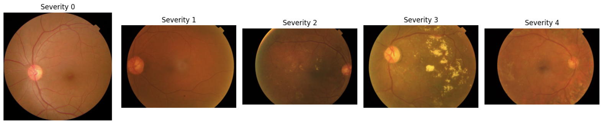
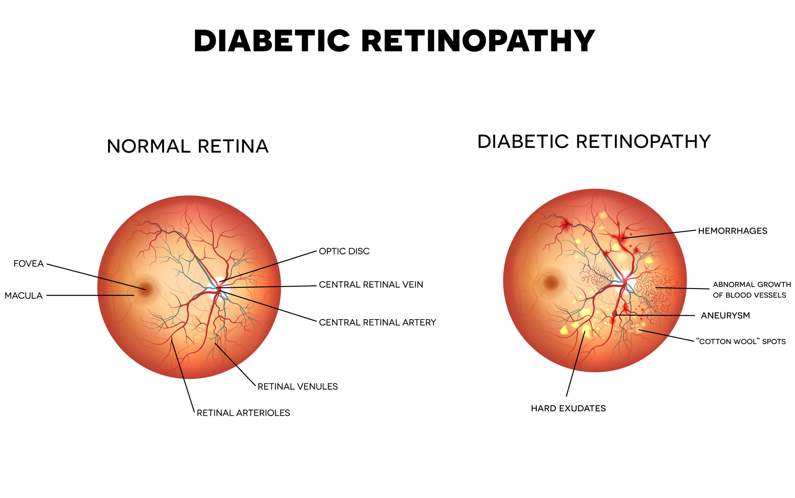

# Exploratory Data Analysis

---

## Background

This dataset comes from Aravind Eye Hospital in India, whose technicians travel to various rural areas to capture retina images. After collection, doctors review the images and diagnose the severity of diabetic retinopathy. In these rural areas, medical screening is difficult to conduct, creating the incentive to develop technology to automatically screen patients for DR to provide early preventative treatment.
The data for this project comes from a [2019 Kaggle competition](https://www.kaggle.com/competitions/aptos2019-blindness-detection/overview), hosted by the Asia Pacific Tele-Ophthalmology Society (APTOS), working with Aravind Eye Hospital. We will be using the train data, which is available on the [competition data tab](https://www.kaggle.com/competitions/aptos2019-blindness-detection/data) (you will need to create a free Kaggle account and accept the competitions terms). Sample images as well as the full preprocessed dataset is available in [this](https://drive.google.com/drive/folders/1ccEqCeUdfJ0LKZAZ7QPXITjSa7noaSzT) Google Drive folder.

## Dataset Description

This dataset includes 3662 retina images using fundus photography, which captures the rear of the eye. Each of these images is labeled by a clinician who estimates the severity of DR. This is a good dataset for our project because all images are relatively easy to process and many contain visible symptoms of DR.



*Figure 1: Retina Fundus Images by Severity Level*

```{admonition} Class Labels
:class: info

**0** → No DR

**1** → Mild

**2** → Moderate

**3** → Severe

**4** → Proliferative
```

## Diagnosing Diabetic Retinopathy

Given a retina image, what characteristics do doctors look for to inform their diagnosis?



*Figure 2: Diabetic Retinopathy Diagram. Source: [Lions Eye Institute](https://www.lei.org.au/services/eye-health-information/diabetic-retinopathy/)*

As you will see in the images on the next page, the most visible signs of DR include hard exudates, hemorrhages, and microaneurysms. Abnormal blood vessel growth is evident in some cases but is harder to detect. In general, a healthy retina appears much more clear, with well-defined retinal veins and consistent coloring.

```{admonition} Key Terms
:class: info

**Blood Vessels:** Thin, branching structures that carry blood throughout the retina. In fundus images, they appear as red lines radiating from the optic disc.

**Hemorrhages:** Bleeding spots within the retina caused by damaged blood vessels. They appear as dark red or blotchy patches and can vary in size.

**Exudates:** Yellow-white deposits made up of lipids and proteins leaked from blood vessels. They often appear as small, bright spots or clusters near the center of the retina.

**Microaneurysms:** Tiny bulges in retinal capillaries and one of the earliest signs of diabetic retinopathy. In images, they look like small, round red dots.
```