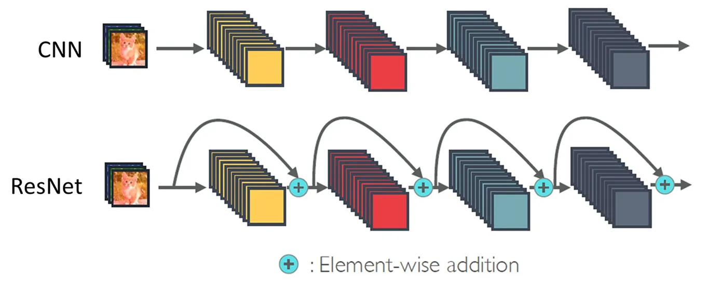
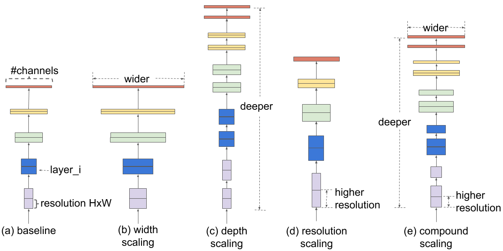

# Modern Deep Learning Methods

While traditional CNNs achieve decent performance, they face several key limitations that prevent optimal results for diabetic retinopathy classification. We will address these with two new CNN architectures: ResNet and EfficientNet.

---

## ResNet (Residual Network)

- Introduced by He et al. ([2015](https://arxiv.org/abs/1512.03385))

#### Vanishing Gradients
CNNs (and neural networks in general) are effective because they are able to learn complex features from data (in this case, image features) in the deep layers of the network. Early layers pick up simple patterns like edges and textures, while deeper layers progressively learn more abstract and complex features like blood vessels and hemorrhages. However, as you add layers to a CNN, they become increasingly difficult to train. This is primarily due to the [vanishing/exploding gradient problem](https://aiml.com/what-do-you-mean-by-vanishing-and-exploding-gradient-problem-and-how-are-they-typically-addressed/), where gradients of the loss function either converge to zero or grow exponentially.

#### How Residual Blocks Can Help
To address this issue, ResNet introduces residual connections (also called skip connections), which allow the network to bypass one or more layers by adding the input of a layer directly to its output. This helps preserve the flow of gradients during backpropagation, making it easier to train very deep networks. Instead of learning a full mapping from input to output, residual blocks encourage the network to learn only the difference (residual) between the input and the output, which is often easier to optimize.



*Figure 1: ResNet Architecture. Source: [Ultralytics](https://www.ultralytics.com/blog/what-is-resnet-50-and-what-is-its-relevance-in-computer-vision)*

#### Why Deeper Networks?
As we explained, deeper layers correspond to more abstract and complex features. ResNet allows us to train much deeper networks with these residual connections, which allows the network to detect the fine-grained pathological features typically linked to diabetic retinopathy.

#### Our Model: ResNet-50
There are many different models of the ResNet family. The one we'll be using is ResNet-50, because it strikes a good balance between depth and computational efficiency. It's deep enough to capture complex image features (with 50 layers), but not so large that it becomes prohibitively slow to train or deploy, making it a practical choice for our dataset.

---

## EfficientNet

- Introduced by Tan and Le ([2019](https://arxiv.org/abs/1905.11946))

#### Network Scaling and Accuracy
Another significant issue CNNs face is that increasing model accuracy often requires increasing the network’s depth, width, or input resolution, typically leading to a large increase in computational cost. Manual scaling is usually done in an unbalanced way, resulting in inefficient models. EfficientNet addresses this by introducing a compound scaling method that uniformly scales all three dimensions (depth, width, and resolution) in a principled way. This results in models that are both more accurate and more efficient.

#### EfficientNet's Compound Scaling
While many CNN architectures focus on scaling either depth, width, or resolution (ResNet focuses on depth), EfficientNet finds a balanced way to scale all three of these together based on a compound coefficient $\phi$. Given $\phi$, EfficientNet scales the network dimensions based on the following formulas:

````{grid} 1 2 2 3
:gutter: 3

```{grid-item-card} Depth
:class-header: bg-primary text-white
- $d = \alpha^{\phi}$
```

```{grid-item-card} Width
:class-header: bg-secondary text-white
- $w = \beta^{\phi}$
```

```{grid-item-card} Resolution
:class-header: bg-success text-white
- $r = \gamma^{\phi}$
```
````



*Figure 2: EfficientNet Compound Scaling. Source: [Google Research](https://research.google/blog/efficientnet-improving-accuracy-and-efficiency-through-automl-and-model-scaling/)*

To ensure the model’s computational cost (FLOPs) remains balanced as it scales, the following constraint is imposed:
- $\alpha \times \beta^2 \times \gamma^2 \approx 2$

This ensures that the computational cost doubles (approximately) for each unit increase in $\phi$.

#### Our Model: EfficientNet-B3

Using the compound scaling formula, the EfficientNet authors began with a carefully designed baseline model, EfficientNet-B0, and applied increasing values of the scaling coefficient $\phi$ to generate a family of models: EfficientNet-B1 through B7. This allows users to choose a model that fits their accuracy and resource constraints without manually tuning architecture size. We will be using EfficientNet-B4 due to our computational constraints, but you are encouraged to experiment with other versions.

```{admonition} Note
:class: info
The EfficientNet-B0 baseline model was built using complicated layers such as MBConv blocks and Squeeze-and-Excitation blocks, which are out of the scope of this project description. For more information, please refer to the original [EfficientNet paper](https://arxiv.org/abs/1905.11946).
```

---

## Fine-Tuning Deep Learning Models

Training these models from scratch is difficult due to time and data constraints. Instead, it's more effective to use pretrained models and fine-tune them to fit our dataset. This is called [transfer learning](https://aiml.com/what-do-you-mean-by-pretraining-finetuning-and-transfer-learning-in-the-context-of-machine-learning-or-language-modeling/) - taking a model previously trained on a similar task and using our limited data to adjust it to our target task.

We will use the pretrained EfficientNet-B3 and Resnet-50 from the PyTorch library. These models were pre-trained on [ImageNet](https://www.image-net.org/), a massive image dataset and computer vision benchmark, and provide strong feature extraction capabilities that transfer well to medical imaging tasks. We replace the final classification layers to output 5 classes corresponding to diabetic retinopathy severity levels (0-4: No DR, Mild, Moderate, Severe, Proliferative DR).

---

ResNet-50 and EfficientNet-B3 should address some of the limitations of our baseline CNN. However, there are several other excellent model architectures that are worth exploring. Here are a few suggestions:
- [DenseNet](https://arxiv.org/abs/1608.06993)
- [InceptionV3](https://arxiv.org/abs/1512.00567)
- [VGG19](https://arxiv.org/abs/1409.1556)
- [Vision Transformers (ViT)](https://arxiv.org/abs/2010.11929)