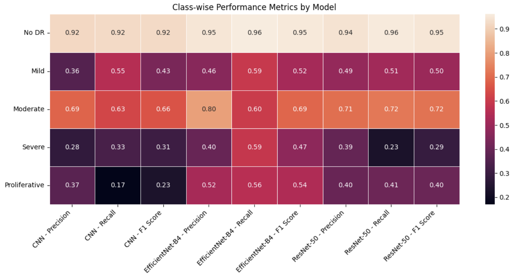
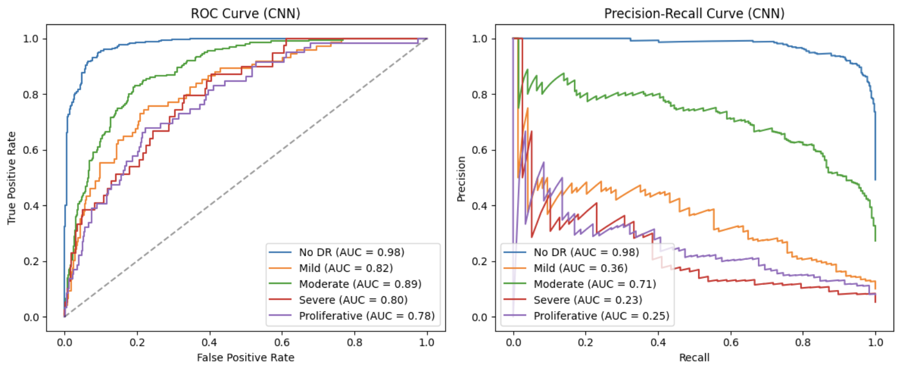
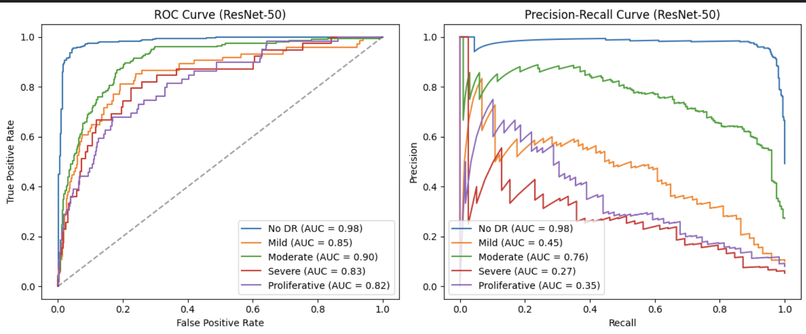
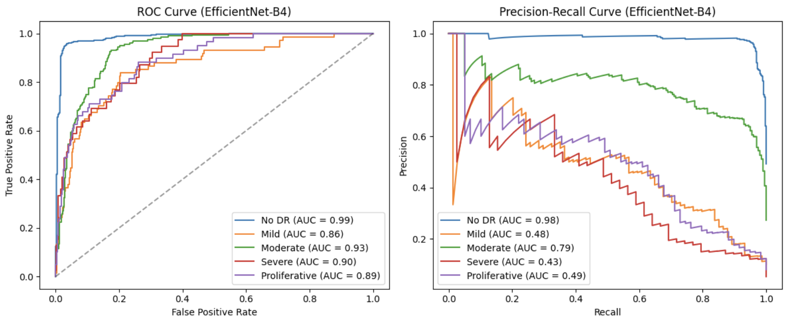
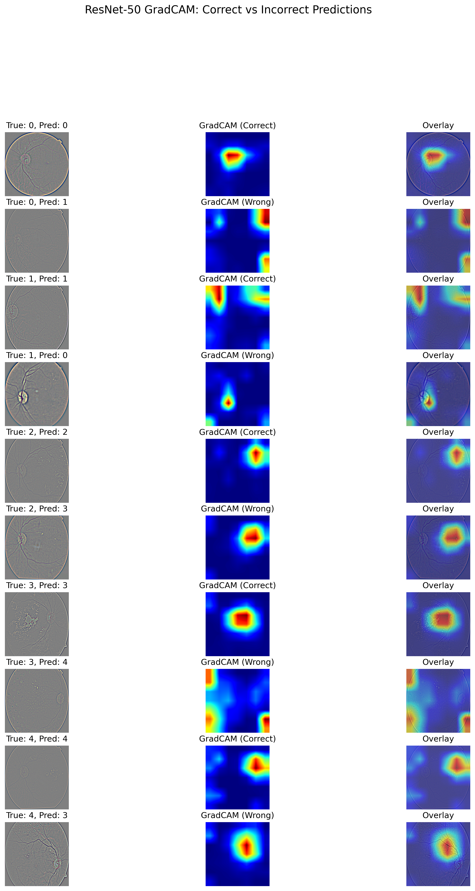
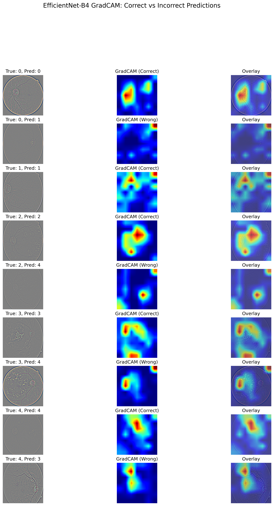

# Comparative Analysis

We've trained a traditional CNN, an EfficientNet-B4 model, and a ResNet-50 model to detect diabetic retinopathy from retina fundus images. Let's take a closer look at the model results to understand how these models performed well, where they could improve, and which model would be ideal for practical use.

---

## Overall Performance
```{literalinclude} outputs/performance_table.md
:language: markdown
```

There is a reasonable ordering of the performance of our three models based on quadratic weighted kappa, precision, recall, and F1-score:

**EfficientNet-B4**
- Achieves the best performance across all metrics. Its high QWK of 0.8339 suggests it limits distant misclassifications and overall makes more accurate classifications.

**ResNet-50**
- Shows moderate performance (0.8136 QWK, 0.7606 F1) but falls just short of EfficientNet's efficiency.

**CNN** 
- The traditional CNN shows the weakest performance in all categories, but the model was able to achieve decent results despite a much simpler architecture and no pre-training. 

This highlights the importance of modern architectures for medical imaging tasks. ResNet-50 and EfficientNet-B4 are much deeper (more layers), which allow them to more effectively capture the fine-grained features necessary for good classification performance. Traditional CNNs struggle with increased depth and are more prone to overfitting.

Performance distributions among these 3 models were consistent for each of our 4 metrics, with EfficientNet achieving the best performance, ResNet achieving a close second best performance, and the CNN trailing behind. The largest gap between the modern deep learning models and traditional CNN was in the QWK results, which indicate that the CNN is much more prone to make distant misclassifications.

---

## Class-Wise Performance


This heatmap shows precision, recall, and F1-score for each model across all 5 classes. One trend immediately stands out - there is a significant inverse severity-performance relationship. As cases get more severe, model performance tends to degrade. Let's first look at each individual model's class-wise performance:

**EfficientNet-B4**
- Achieves the highest F1-score in 4 out of the 5 classes, demonstrating consistent performance through various cases. Its performance on proliferative cases is particularly noteworthy, achieving above 50% on precision, recall, and F1.

**ResNet-50** 
- Achieves competitive scores and performs best on moderate cases but struggles with severe and proliferative cases - the most clinically urgent categories.

**CNN** 
- Trails significantly across all classes with the lowest average, particularly struggling with severe and proliferative cases as well.

Again, EfficientNet-B4 emerges as the preferred model, not purely because of its overall performance, but specifically because of its vastly superior performance on severe and proliferative cases. Recall is very important here - we want the model to identify as many high-severity cases as possible, and EfficientNet-B4 does so much better than ResNet-50 or the baseline CNN.

---

## ROC and PR Curves

ROC (Receiver Operating Characteristic) and PR (Precision-Recall) curves are important to visualize how well a model distinguishes between classes, especially in imbalanced datasets.





These curves visually demonstrate the inverse severity-performance relationship, with class 0 closely aligning with the top border while more severe classes fall below. EfficientNet's ROC and PR curves, particularly for classes 2, 3 and 4, align very closely in accordance with the model's more consistent performance on underrepresented cases. The baseline CNN and ResNet, on the other hand, show a bit more variability.

---

## Explainability and Feature Analysis

It's important we analyze what features our models focused on to make their classifications. [Grad-CAM](https://arxiv.org/abs/1610.02391) (Gradient-weighted Class Activation Mapping) works by using the gradients of the target class flowing back into the final convolutional layer to produce a coarse localization map highlighting the important regions in the image for predicting that class. Specifically, it computes the gradients of the class score with respect to feature maps in the last convolutional layer, then performs a weighted combination of forward activation maps using these gradients as importance weights. This process generates a heatmap that shows which pixels in the original retinal image most strongly influenced the model's decision to classify it as a particular severity level.

---


The attention maps for the baseline CNN highlight important shortcomings of this model. With the exception of class 3, these images show that the model mostly focuses on the circular boundary of the eye rather than relevant pathological features. This may be due to the CNN focusing on high-contrast areas with strong edges as they are easiest to detect in shallow layers. This architecture may not be deep enough or may need further training for better feature detection.

---



The activations for our ResNet model are quite different. Areas of activation are much larger and much more concentrated, appearing more red. While some mappings seem to pick up on relevant areas of the retina, others focus on outer edges, much like our CNN. This seems to be most common for misclassifications, most notably in the second and eighth pairs of heatmaps. It's important to note that this is also a pretrained model and may be more suited to images with coarser patterns.

---



The EfficientNet activation maps show strong activations, much like ResNet, but rather than single blobs, they tend to focus on various specific parts of the retina. These activations appear to follow blood vessels and pick up on exudates or hemorrhages. Still, we see a couple cases (second and eighth pairs) which focus on the eye border. Overall, these activations show attention to relevant pathological features, demonstrating that the EfficientNet model was able to learn these fine-grained details and connect them to corresponding severity levels. 