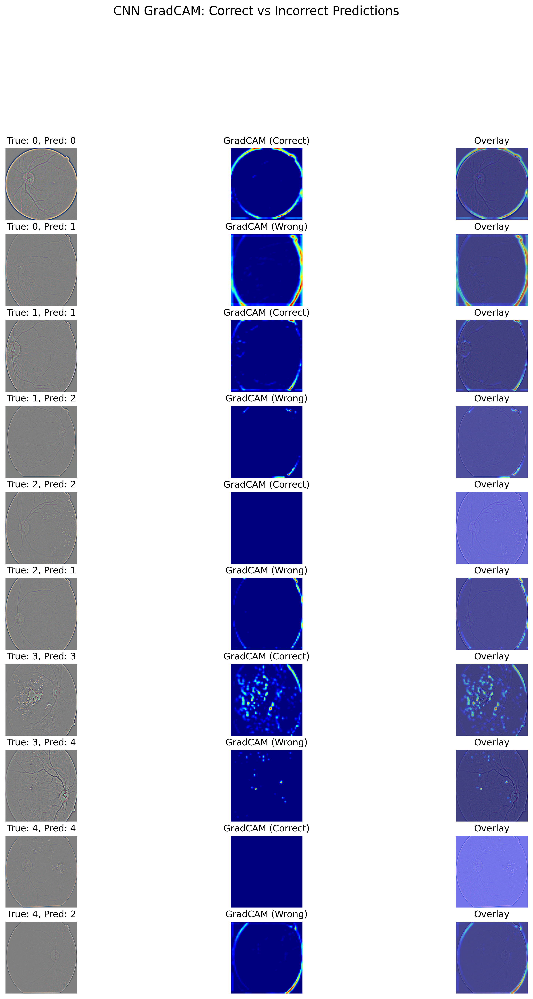
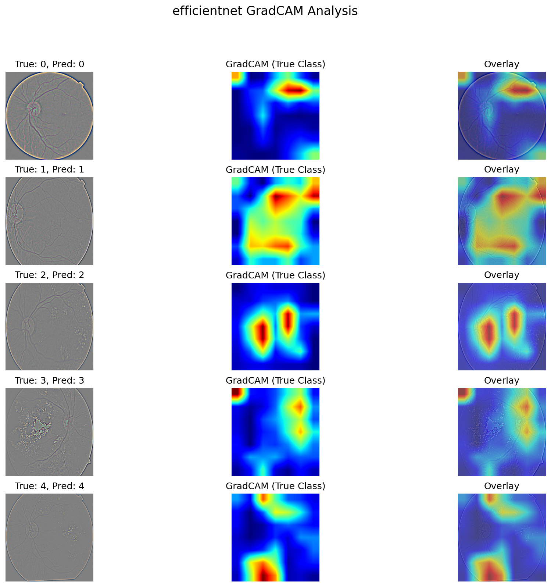
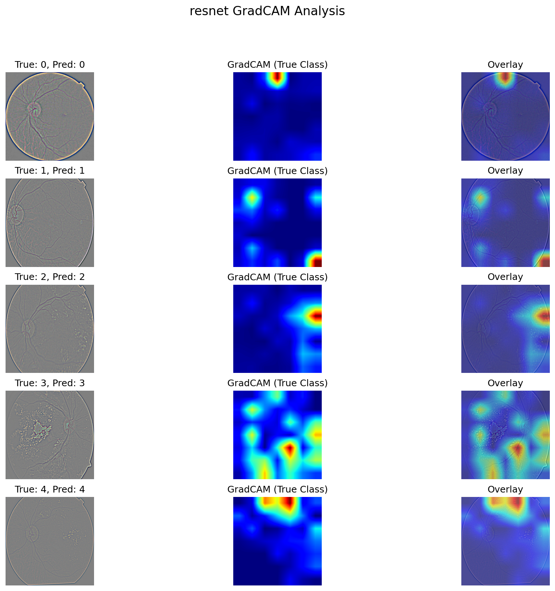

# Comparative Analysis

We've trained a traditional CNN, an EfficientNet-B3 model, and a ResNet-50 model to detect diabetic retinopathy from retina fundus images. Let's take a closer look at the model results to understand how these models performed well, where they could improve, and which model would be ideal for practical use.

---

## Model Performance

### Overall Performance
```{literalinclude} outputs/performance_table.md
:language: markdown
```
There is a clear ordering of the performance of our three models:

**EfficientNet-B3**
- Achieves the highest balanced accuracy (63.0%), best quadratic weighted kappa (0.849), and lowest error rate (37.0%). This suggests it handles class imbalance better and makes more clinically appropriate predictions for ordinal DR severity.

**ResNet-50**
- Shows moderate performance (56.2% balanced accuracy, 0.811 QWK) but falls short of EfficientNet's efficiency.

**CNN** 
- Despite being trained on the same data, the traditional CNN shows the weakest performance (49.7% balanced accuracy), with an error rate exceeding 50%. This highlights the importance of modern architectures for medical imaging tasks.

The QWK scores above 0.8 for EfficientNet and ResNet indicate great agreement for ordinal classification, suggesting both models appropriately penalize distant misclassifications (e.g., classifying severe DR as mild). However, EfficientNet's superior balanced accuracy makes it the preferred choice for deployment in DR screening systems.


### Class-Wise Performance
```{literalinclude} outputs/classwise_table.md
:language: markdown
```

This table shows F1-scores for each model across all 5 classes. The F1-score comparison reveals EfficientNet-B3's clear superiority across most DR severity levels, with concerning performance gaps that highlight the challenge of detecting severe cases.

**EfficientNet-B3**
- Leads in 4 out of 5 classes with the highest overall average, demonstrating consistent performance through various cases. Its 48.7% F1-score on Proliferative DR is particularly noteworthy - nearly 4x better than ResNet-50.

**ResNet-50** 
- Achieves competitive scores on No DR (0.955) and claims the only victory on Severe DR (0.385), but catastrophically fails on Proliferative cases (0.130) - the most clinically urgent category.

**CNN** 
- Trails significantly across all classes with the lowest average, particularly struggling with mild cases.

A clear inverse severity-performance relationship emerges:

- No DR (0.950 avg): Excellent detection across all models
- Moderate (0.741 avg): Strong but declining performance
- Mild (0.500 avg): Moderate detection capability
- Severe (0.346 avg): Poor performance when intervention is critical
- Proliferative (0.290 avg): Worst performance for sight-threatening case


### Failure Case Analysis
```{literalinclude} outputs/failure_table.md
:language: markdown
```

**EfficientNet-B3**
- Lowest overall error rate (19.65%)
- Best at avoiding distant errors
- Fewest critical misses (45)
- Most errors are adjacent classifications (67.4%), which is better for ordinal data

**ResNet-50**
- Middle-ground error rate (21.28%)
- Reasonable distant error control (37.8%)
- However, highest critical miss percentage (46.8%)

**CNN**
- Highest error rate (26.47%)
- Nearly balanced between adjacent and distant errors (52.1% vs 47.9%)
- High critical miss rate (37.6% of total errors)
- Makes almost twice as many distant errors as EfficientNet-B3


EfficientNet-B3's error pattern is ideal for ordinal data - when it makes mistakes, they're mostly adjacent class confusions rather than severe distant errors.

---

## Explainability and Feature Analysis

It's important we analyze what features our models focused on to make their classifications. Grad-CAM (Gradient-weighted Class Activation Mapping) works by using the gradients of the target class flowing back into the final convolutional layer to produce a coarse localization map highlighting the important regions in the image for predicting that class. Specifically, it computes the gradients of the class score with respect to feature maps in the last convolutional layer, then performs a weighted combination of forward activation maps using these gradients as importance weights. This process generates a heatmap that shows which pixels in the original retinal image most strongly influenced the model's decision to classify it as a particular severity level.

---



With fewer layers and a simpler architecture, our traditional CNN's receptive field is much smaller. As a result, the Grad-CAM heatmaps show fine-grained activations. These mostly appear along the blood vessels and cover small bright spots, possibly representing exudates or microaneurysms. 

---



The attention maps for EfficientNet show large, diffuse blobs rather than precise focus on distinct pathological features. Despite some visible exudates and hemorrhages, the heatmaps seem to ignore some of them. This could have something to do with EfficientNet's compound scaling, which can oversmooth features from downsampling. This is also a pretrained model and may be more suited to images with coarser patterns. 

---



Although these attention maps contain odd patterns, ResNet shows some more anatomically coherent attention patterns. Attention is more localized and tends focuses on distinct pathological features rather than large diffuse areas. However, the attention maps shows activation at the image borders, indicating the model may be relying on irrelevant artifacts. Additionally, many points of focus don't appear to represent clear DR symptoms.